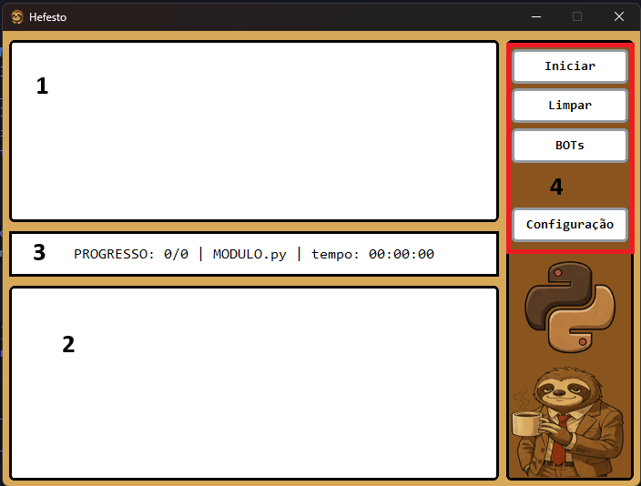
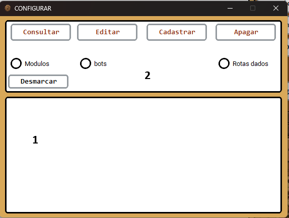
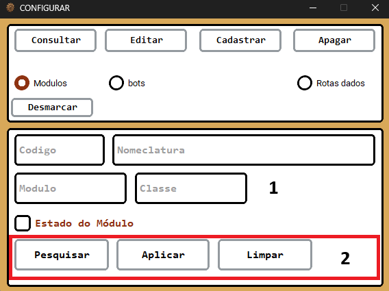
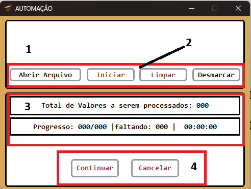
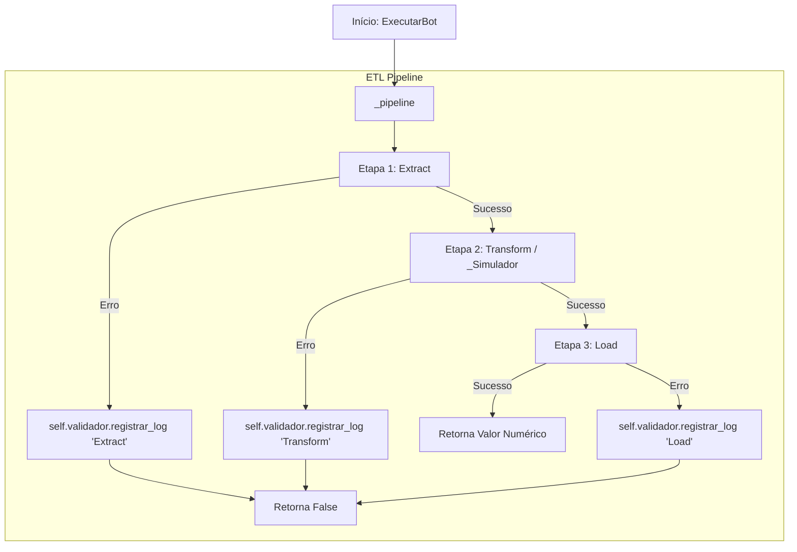
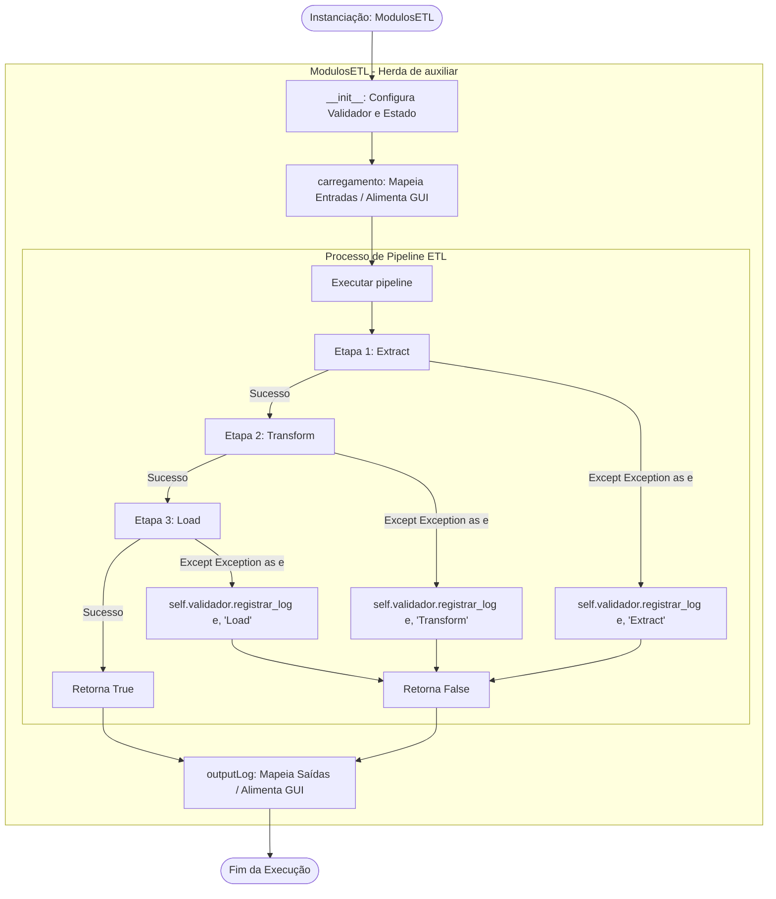

<table align="center">
<tr>
<!-- Lado Esquerdo: Frase, Links e Badges -->
<td align="center" valign="middle">
    <h3 align="center">Hefesto 🦥</h3>
    <h3>"Deixe o robô trabalhar enquanto você toma um café."</h3>
    <h2>
        <a href="https://www.linkedin.com/in/wesley-henrique22" target="_blank" rel="noopener noreferrer">LinkedIn</a> |
        <a href="https://github.com/wesley-henrique1" target="_blank" rel="noopener noreferrer">GitHub</a> | 
        <a href="https://www.bing.com/search?q=aqui%20estou%20devendo%20link&qs=n&form=QBRE&sp=-1&ghc=1&lq=0&pq=aqui%20estou%20devendo%20link&sc=12-23&sk=&cvid=989C403393164B4298A65FE780076F4B" target="_blank" rel="noopener noreferrer">Instagram</a>
    </h2>
    <p align="center">
        
        
        
        
    </p>
</td>
<!-- Lado Direito: Imagem Principal -->
<td align="center" valign="middle" width="300">
    
</td>
</tr>
</table>

<hr>

# 🎯 Objetivo do Projeto

Centralizar e gerenciar a execução de automações e pipelines de dados em um painel único. A plataforma elimina a execução manual de scripts `.py` no terminal/IDE, organizando as operações através de uma interface gráfica amigável.

## 📑 Índice
1. [Manual de Uso](#-manual-de-uso)
2. [Arquitetura dos Módulos Bots (RPA)](#️-arquitetura-dos-módulos-bots-rpa)
3. [Arquitetura dos Módulos Pipelines](#️-arquitetura-dos-módulos-pipelines)


<hr>

## 📖 Manual de Uso
Para que o **Hefesto** funcione corretamente e consiga localizar todos os componentes, é necessário cadastrar previamente três ferramentas essenciais: **módulos**, **bots** e **rotas**. Cada uma delas segue regras de configuração específicas exigidas pelo sistema.
<div align="center">

  <h3>🖥️ Visão Geral da Interface Principal</h3>
  <br>

  <!-- Imagem da Interface Centralizada -->
  

</div>

<br>

* **1. Painel de Pipelines:** Centraliza as marcações de seleção para definir quais módulos serão executados ao acionar o botão de início.
* **2. Painel de Log/Exibição:** Área destinada a exibir as informações e o histórico de processamento dos dados utilizados nos pipelines.
* **3. Barra de Progresso:** Monitora em tempo real o andamento da execução atual, exibindo o módulo ativo e o tempo decorrido de atividade.
* **4. Painel de Controle (Botões):**
  * **Iniciar:** Executa todos os pipelines selecionados.
  * **Limpar:** Reseta a janela e limpa as informações da tela.
  * **BOTs:** Abre a interface dedicada às automações; para essa interface funcionar, é preciso ter uma pasta de saída já cadastrada no banco de dados com o nome de variável `_Saidas_`.
  * **Configuração:** Abre o painel de gerenciamento completo para consultar, cadastrar, editar e apagar rotas, módulos e bots.

<hr>

<div align="center">
  <h3>⚙️ Painel de Configuração</h3>
  <br>
  
</div>

<br>

* **1. Área de Exibição e Alteração (CRUD):** Espaço dinâmico inferior onde são carregados os formulários, tabelas e campos para gerenciar os registros selecionados.
* **2. Painel de Controle e Filtros:**
  * **Botões de Ação (Consultar, Editar, Cadastrar, Apagar):** Define qual operação do CRUD será executada no sistema.
  * **Seletores de Entidade (Modulos, bots, Rotas dados):** Rádio buttons para escolher qual base de dados ou módulo será o alvo da operação.
  * **Desmarcar:** Limpa os campos da tela de alteração e reseta as seleções de rádio.\

<hr>
<div align="center">
  <h3>⚙️ Configuração: Ação</h3>
  <br>
  
</div>

<br>

* **1. Painel de Entradas:** Centraliza os campos de texto e caixas de seleção dinâmicas para receber ou exibir os valores nas modalidades de **editar, cadastrar e apagar**.
* **2. Painel de Ações (Botões):**
  * **Pesquisar:** Busca no banco de dados os valores correspondentes à chave (código), preenchendo os demais campos automaticamente (fica desabilitado no modo de cadastro).
  * **Aplicar:** Envia e salva as informações processadas no banco de dados.
  * **Limpar:** Reseta a janela de ação e limpa todas as informações preenchidas na tela.

<hr>

<div align="center">
  <h3>🤖 Painel de Automação (BOT)</h3>
  <br>
  
</div>

<br>

* **1. Painel de Seleção:** Centraliza as marcações de opção para definir qual bot será executado ao acionar o botão de início (permitindo a seleção de apenas um por vez).
* **2. Painel de Controle (Ações):**
  * **Abrir Arquivo:** Abre a planilha Excel base onde o bot coletará os dados de entrada necessários para a execução. É fundamental executá-lo antes de iniciar o bot.
  * **Iniciar:** Executa o bot selecionado na lista.
  * **Limpar:** Reseta a janela e limpa as informações exibidas na tela.
  * **Desmarcar:** Limpa as seleções (flags) ativas.
* **3. Painel de Progresso:** Monitora em tempo real o andamento da automação, exibindo o total de valores a serem processados, o progresso atual do pipeline do bot e o tempo decorrido de atividade.
* **4. Painel de Controle (Simulador):**
  * **Continuar:** Liberado automaticamente após o término do pipeline, permitindo iniciar a etapa do simulador ao ser clicado.
  * **Cancelar:** Interrompe e cancela a execução atual do processo.

<hr>
<br><br>

## 🏗️ Arquitetura dos Módulos Bots (RPA):
>### 💻 Código-Fonte
```python
import pandas as pd
from pathlib import Path

import time
import pyperclip as pc
import pyautogui as pag
    

class auxiliar:
    def _conversaUI(self, fase, total_itens, tempo):
        """
        Atualiza a interface gráfica do bot em tempo real com o progresso atual,
        calculando o tempo decorrido e exibindo os itens restantes.
        """
        if hasattr(self, 'cancel_event') and self.cancel_event.is_set():
            return
            
        fim = time.perf_counter()
        tempo_segundos = fim - tempo
        texto = f"Progresso: {fase}/{total_itens} | faltando: {total_itens - fase} | {tempo_segundos:.0f}s"

        # Verifica de forma segura se o componente de UI e o contador existem antes de atualizar
        if hasattr(self, 'ancoraUI') and self.ancoraUI:
            if hasattr(self.ancoraUI, 'contador') and self.ancoraUI.contador:
                try:
                    self.ancoraUI.contador.after(0, lambda t=texto: self.ancoraUI.contador.configure(text=t))
                except Exception:
                    pass

    def _sleep_verificando(self, segundos, cancel_event, _parar_execucao):
        """
        Realiza uma pausa (sleep) fracionada e inteligente, verificando periodicamente
        se o usuário solicitou a parada ou o cancelamento da execução.
        """
        passos = int(segundos * 10)
        for _ in range(max(1, passos)):
            if _parar_execucao or (cancel_event and cancel_event.is_set()):
                return False
            time.sleep(segundos / max(1, passos))
        return True
    
    def _copiar_e_validar(valor, tentativas=5):
        """
        Copia um valor para a área de transferência do sistema operacional e valida
        repetidamente se foi copiado com sucesso antes de permitir a continuação.
        """
        str_valor = str(valor)
        pc.copy(str_valor)
        for _ in range(tentativas):
            if pc.paste() == str_valor:
                return True
            pag.sleep(0.1)
            pc.copy(str_valor)
        return False
    
    def _copiar_e_validar(valor, tentativas=5):
        str_valor = str(valor)
        pc.copy(str_valor)
        for _ in range(tentativas):
            if pc.paste() == str_valor:
                return True
            pag.sleep(0.1)
            pc.copy(str_valor)
        return False

class TesteBot:
    def __init__(self,UI, rotas: dict, entrada: Path, saida: Path):
        self.ancoraUI = UI
        self._parar_execucao = False
        self.velocidade = 0.05
        self.rota = rotas

        self.saida = saida
        self.Entrada = str(entrada)
        pass
    def Controladora(self, valor: bool = True):
        self._parar_execucao = valor
    
    def _pipeline(self):
        # 1. Extração de dados
        try:
            # Lógica de extração aqui
            pass
        except Exception as e:
            print("Erro na Extração:", e)
            return False

        # 2. Tratamento / Transformação de dados
        try:
            # Lógica de tratamento aqui
            pass
        except Exception as e:
            print("Erro na Tratamento:", e)
            return False

        # 3. Carga / Salvamento dos dados
        try:
            # Lógica de carga aqui
            # Sempre retorna um valor numérico (int ou float) indicando o total processado/carregado
            return 1
        except Exception as e:
            print("Erro na Carga:", e)
            return False
            
    def _simulador(self, df: pd.DataFrame, cancel_event=None):
        try:
            lista = []
            total_itens = len(df)
            inicio = time.perf_counter()
            
            for fase, (_, registro) in enumerate(df.iterrows(), 1):
                if self._parar_execucao or (cancel_event and cancel_event.is_set()): break
                
                auxiliar._conversaUI(self, fase=fase, total_itens=total_itens, tempo= inicio)

                # Pode colocar esse formato pelo decorrer do codigo, vai parar o script ou pausar para da respito
                if not auxiliar._sleep_verificando(self.velocidade, self._parar_execucao, cancel_event): break

                """A QUI PODE DA SEQUENCIA NAS INSTRUÇÁO DO pyperclip OU pyautogui"""

                """Aqui vai esta alimentando a lista com as fase para depois validar se mandou tudo correto"""
                lista.append(fase)
            return len(lista)
        except Exception as e:
            print("simulador", e)
```

> 1. `auxiliar` (Classe Auxiliar) <br>
**Responsabilidade:** Agrupar funções utilitárias e ajudantes (*helpers*) secundárias que suportam as regras de negócio ou transformações genéricas de dados.

> 2. `NomeDomodulo` (Classe Principal de Pipeline) <br>
**Responsabilidade:** Orquestrar o ciclo de vida completo do processamento de dados de produtos, incluindo a simulação, etapas de ETL e controle do fluxo do bot.

<hr>

> ### 📋 Resumo dos Métodos
| Método | Visibilidade | Responsabilidade |
| :--- | :--- | :--- |
| `_conversaUI(fase, total_itens, tempo)` | Privado / Auxiliar | Atualiza a interface gráfica do bot em tempo real com o progresso atual, itens restantes e tempo de execução. |
| `_sleep_verificando(segundos, cancel_event, _parar_execucao)` | Privado / Auxiliar | Pausa a execução por partes, verificando periodicamente se o usuário cancelou o processo para interromper na hora. |
| `_copiar_e_validar(valor, tentativas=5)` | Privado / Auxiliar | Copia um valor para a área de transferência e valida repetidamente se foi copiado com sucesso antes de prosseguir. |
| `__init__()` | Público | Inicializa os atributos da classe, como instâncias do validador/logger e configurações do ambiente. |
| `Controladora(valor: bool = True)` | Público | Altera o estado de execução do bot (`_parar_execucao`), permitindo interromper processos em andamento. |
| `_pipeline()` | Público | Executa as fases operacionais do ETL (Extração, Transformação e Carga) com captura individual de exceções por etapa. |
| `_Simulador(df, cancel_event=None)` | Público | Controla o loop principal de execução linha a linha do DataFrame, gerenciando o tempo de processamento, checagem contínua de cancelamento, atualização de interface e execução das instruções de automação. |

---
> ### 🔄 Fluxo de Execução (Diagrama ETL)


## 🏗️ Arquitetura dos Módulos Pipelines:
>### 💻 Código-Fonte
```python
from src.lib.valerros import ValidarErros
from datetime import datetime as dt
from pathlib import Path

class auxiliares:
    def MontarRota(self, dictRota: dict):
        listBase = []       

        # aqui você vai passar as variaveis que precisa no pipeline seguindo sua ordem
        variaveis_validas = []
        for item in dictRota.values():
            if item.get("VARIAVEL") in variaveis_validas:
                listBase.append(item.get("PATH"))
        return listBase

    pass
class NomeModulo(auxiliares):
    def __init__(self, rotas):
        self.rotas = self.MontarRota(dictRota= rotas)
        self.list_path = self.rotas[:-1]
        self.caminho = self.rotas[-1] / "Analitico Cadastro.xlsx"
        
        """Resto do seu codigo"""
        pass
    def pipeline(self):
        """Resto do seu codigo"""
        return True

    def carregamento(self):
        lista_de_logs = []
        try:
            for path in self.list_path:
                nome_file = path.name
                data_file = path.stat().st_mtime
                data_modificacao = dt.datetime.fromtimestamp(data_file)
                data_formatada = data_modificacao.strftime("%d/%m/%Y")
                horas_formatada = data_modificacao.strftime("%H:%M:%S")
                dic_log = {
                    "ARQUIVO" : nome_file
                    ,"DATA" : data_formatada
                    ,"HORAS" : horas_formatada
                }
                lista_de_logs.append(dic_log)
            return lista_de_logs
        except Exception as e:
            # self.validador.registrar_log(e, "CARREGAMENTO")
            print("CARREGAMENTO", e)
            return False
    def Saida(self):
        return [self.caminho]

```
> 1.  `auxiliar` (Classe Auxiliar) <br>
**Responsabilidade:** Concentra funções secundárias e operacionais (como validações, formatação de tipos, sanitização de strings e tratamento de exceções) que dão suporte à execução das regras de negócio do módulo de ETL, evitando duplicação de código.

> 2. `NomeModulo` (Classe Principal de Pipeline) <br>
 **Responsabilidade:** Responsável por localizar, ler e mapear as bases de dados de origem, executar a sequência de transformações necessárias e salvar/entregar os dados processados na camada de saída ou no destino final do pipeline.

<hr>

>### 📋 Resumo dos Métodos
| Método | Visibilidade | Responsabilidade |
| :--- | :--- | :--- |
| `__init__()` | Público | Inicializa os atributos da classe, como instâncias do validador/logger e configurações do ambiente. |
| `pipeline()` | Público | Executa as fases operacionais do ETL (Extract, Transform, Load) com captura individual de exceções por etapa. |
| `carregamento(self)` | Público | Mapeia e valida os arquivos e bases de entrada do pipeline, consolidando os metadados em um dicionário para alimentação da interface (GUI).|
| `Saida(self)` | Público |  Entrega a rota do arquivo gerado pelo pipeline|


<hr>

>### 🔄 Fluxo de Execução (Diagrama ETL)

<hr>
