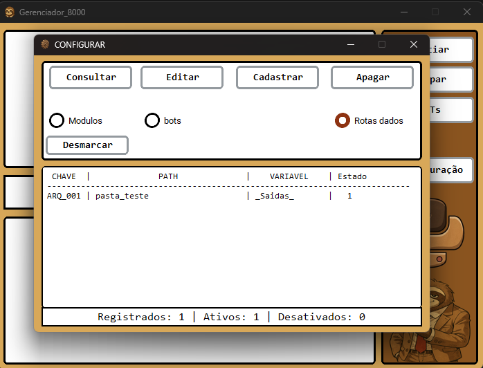

# hefesto
projeto destinado a centralizar os script de automação 


como utilizar 
para utilizar o gerenciar sempre se contente a cadastrar corretamente rota da base de dados, vai esta cadastrada uma rota pronta de sainda, sem ela a tela de bot náo vai fucionar,


cada modulo ou bot tem que que seguir a estrutura abaixo 

modulo:

pytohn: ```
class auxiliares:
    def MontarRota(self, dictRota: dict):
        listBase = []       

        # aqui você vai passar as variaveis que precisa no pipeline seguindo sua ordem
        variaveis_validas = []
        for item in dictRota.values():
            if item.get("VARIAVEL") in variaveis_validas:
                listBase.append(item.get("PATH"))
        return listBase

    pass
class NomeModulo(auxiliares):
    def __init__(self, rotas):
        self.rotas = self.MontarRota(dictRota= rotas)
        self.list_path = self.rotas[:-1]
        self.caminho = self.rotas[-1] / "Analitico Cadastro.xlsx"
        
        """Resto do seu codigo"""
        pass
    def pipeline(self):
        """Resto do seu codigo"""
        return True
    def carregamento(self):
        lista_de_logs = []
        try:
            for path in self.list_path:
                nome_file = path.name
                data_file = path.stat().st_mtime
                data_modificacao = dt.datetime.fromtimestamp(data_file)
                data_formatada = data_modificacao.strftime("%d/%m/%Y")
                horas_formatada = data_modificacao.strftime("%H:%M:%S")
                dic_log = {
                    "ARQUIVO" : nome_file
                    ,"DATA" : data_formatada
                    ,"HORAS" : horas_formatada
                }
                lista_de_logs.append(dic_log)
            return lista_de_logs
        except Exception as e:
            # self.validador.registrar_log(e, "CARREGAMENTO")
            print("CARREGAMENTO", e)
            return False
    def Saida(self):
        return [self.caminho]
```

bot:

class auxiliar:
    def conversaUI(self, fase, total_itens, tempo_segundos):
        if hasattr(self, 'cancel_event') and self.cancel_event.is_set():
            return

        texto = f"Progresso: {fase}/{total_itens} | faltando: {total_itens - fase} | {tempo_segundos:.0f}s"

        if hasattr(self, 'ancoraUI') and self.ancoraUI:
            if hasattr(self.ancoraUI, 'contador') and self.ancoraUI.contador:
                try:
                    self.ancoraUI.contador.after(0, lambda t=texto: self.ancoraUI.contador.configure(text=t))
                except Exception:
                    pass
    def _copiar_e_validar(valor, tentativas=5):
        str_valor = str(valor)
        pc.copy(str_valor)
        for _ in range(tentativas):
            if pc.paste() == str_valor:
                return True
            pag.sleep(0.1)
            pc.copy(str_valor)
        return False
class NomeDomodulo:
    def __init__(self,UI, rotas: dict, entrada: Path, saida: Path):
        self.ancoraUI = UI
        self._parar_execucao = False
        self.velocidade = 0.05
        self.rota = rotas

        self.saida = saida
        self.Entrada = str(entrada)
        pass
